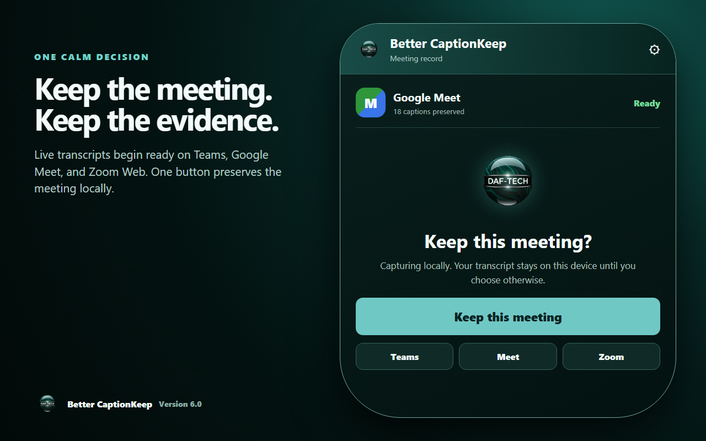

# Better CaptionKeep 6.0.3

**A DAF-TECH product — Keep the meeting. Keep the evidence.**

Better CaptionKeep captures captions displayed in Microsoft Teams, Google Meet and Zoom Web, then keeps a local transcript and source-linked meeting evidence. It does not record microphone audio or video, run a meeting bot, or operate a publisher transcript-upload service.

## Guided Microsoft 365 setup. Deploy Better CaptionKeep with Intune.

For personal use, [install the extension](Installation) and [capture your first meeting](Getting-Started). For a Windows organization using Microsoft 365 and Intune, start with [guided Administrator Deployment](Administrator-Deployment): connect your organization, choose Edge or Chrome and a pilot group, then review the changes before approving them. Review [security and permissions](Deployment-Security-and-Permissions) alongside setup.

Better CaptionKeep is one free product; organization setup does not introduce an Enterprise paywall. Microsoft licensing, browser support and administrator authority still apply. Ongoing Intune-console settings editing is a later feature under testing. See [Release status](Release-Status) for current versions and evidence. Safari and MCP connections/tool execution are deferred.

The 6.0.3 update adds **Open administrator setup** in **All Settings → Microsoft 365** to launch or install the signed setup app. The guided route avoids manually creating app registrations or copying tenant and client IDs between portals. The release status records when this extension update becomes public.

*Bold DAF-TECH campaign artwork approved by the product owner on October 24. Product panels are illustrations with synthetic data; artwork approval is separate from browser certification and release approval.*

## Start here

1. [Install Better CaptionKeep](Installation).
2. [Capture your first meeting](Getting-Started).
3. [Review, save and export](Review-Save-and-Export).
4. [Understand privacy and data boundaries](Privacy-and-Data-Boundaries).

The 6.0 working product includes the Live Workspace, local Meeting Receipts/history, Evidence Board, reviewed Capture Moments, cited Notes and Ask, reusable local templates, exports and reviewed shareable summaries. Original captions remain authoritative; derived notes, images, answers and corrections stay separate. Optional AI handoff remains user-directed.

The dark teal DAF-TECH interface is the default. The Theme selector calls that default **CaptionKeep** and also offers Light, Midnight, Slate, High contrast and Follow system. Choosing High contrast is a personal setting; it does not change the product's default or certify accessibility.

## Public installation and release history

- [Chrome Web Store](https://chromewebstore.google.com/detail/better-captionkeep/nabjdlnkkaonnbnimnmnhjcbigceebml)
- [Microsoft Edge Add-ons](https://microsoftedge.microsoft.com/addons/detail/better-captionkeep/edefcbdhahfolgkoamkbknjppojpaffk)

The Chrome listing checked November 16 shows 6.0.0. The owner confirmed 6.0 in both Stores on October 25. The Windows Administrator Setup application has its own version, currently 6.0.3. [Release status](Release-Status) records those observations separately from future updates and historical incidents.

For local builds and controlled testing, use [Development and UAT](Development-and-UAT).

## Need help?

[Troubleshooting](Troubleshooting) · [Support](Support) · [Release status](Release-Status) · [Administrator deployment](Administrator-Deployment)

The [repository](https://github.com/Mr-GraphnStaff/better-captionkeep) preserves source, release evidence, security/privacy documents, the MIT license and original attribution.
