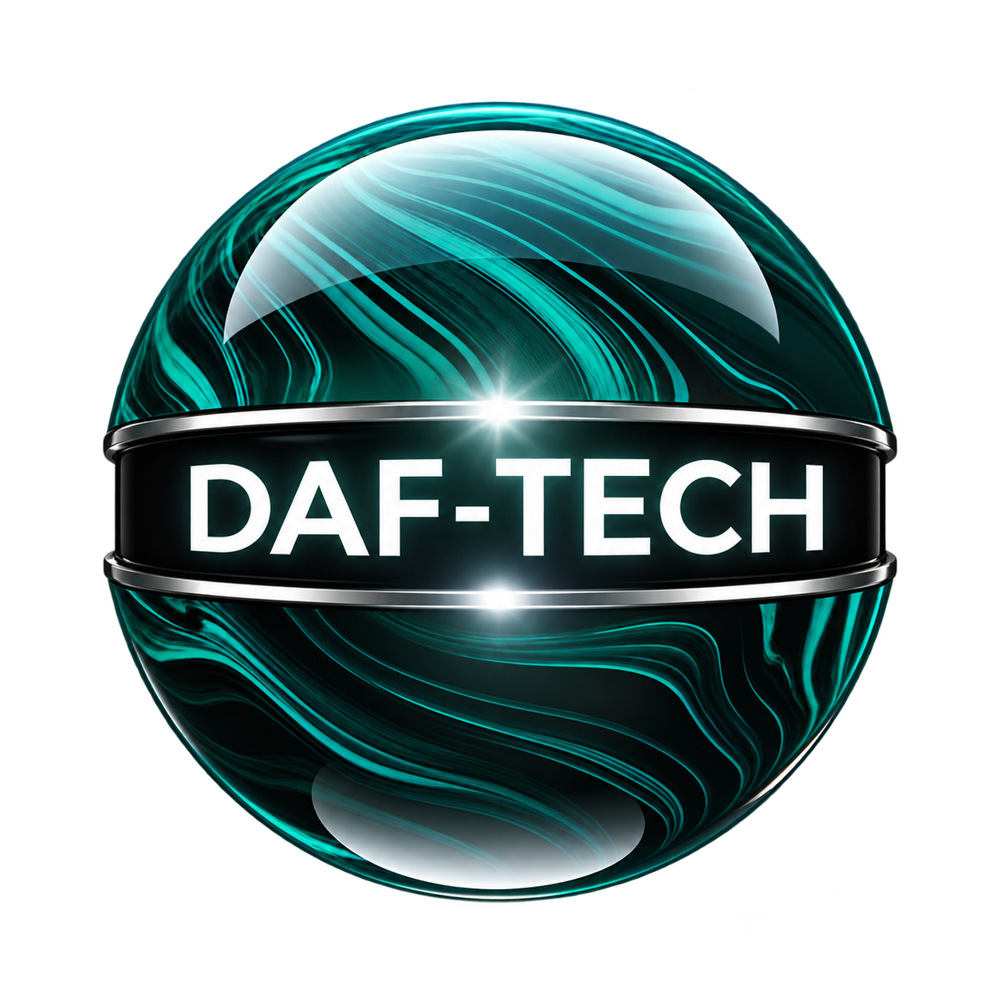
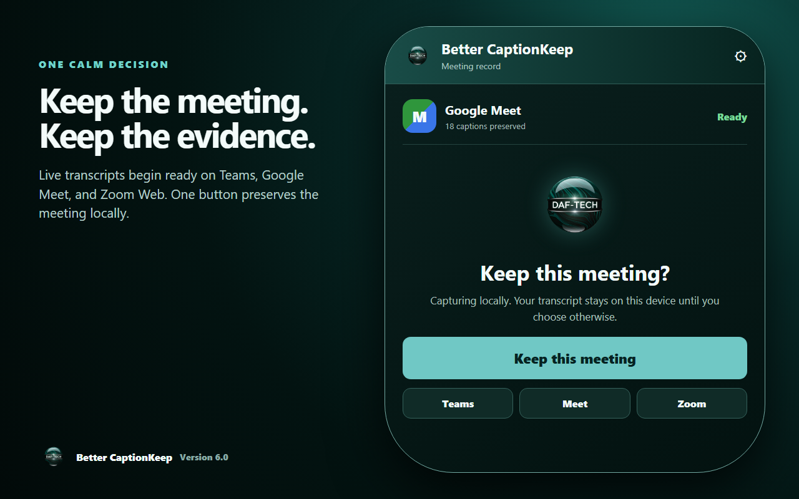
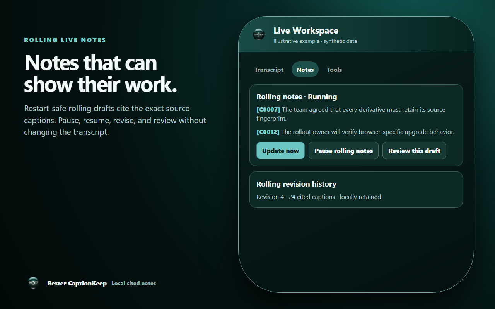
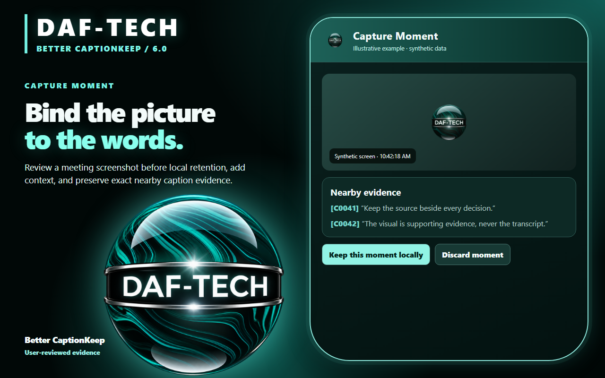
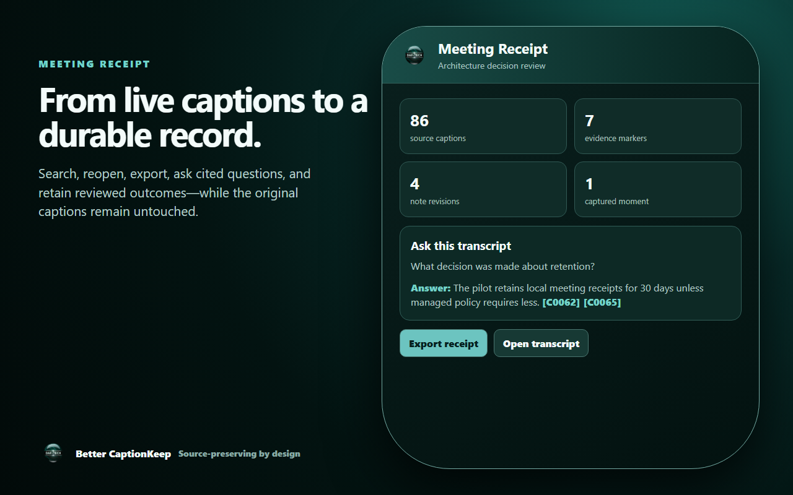
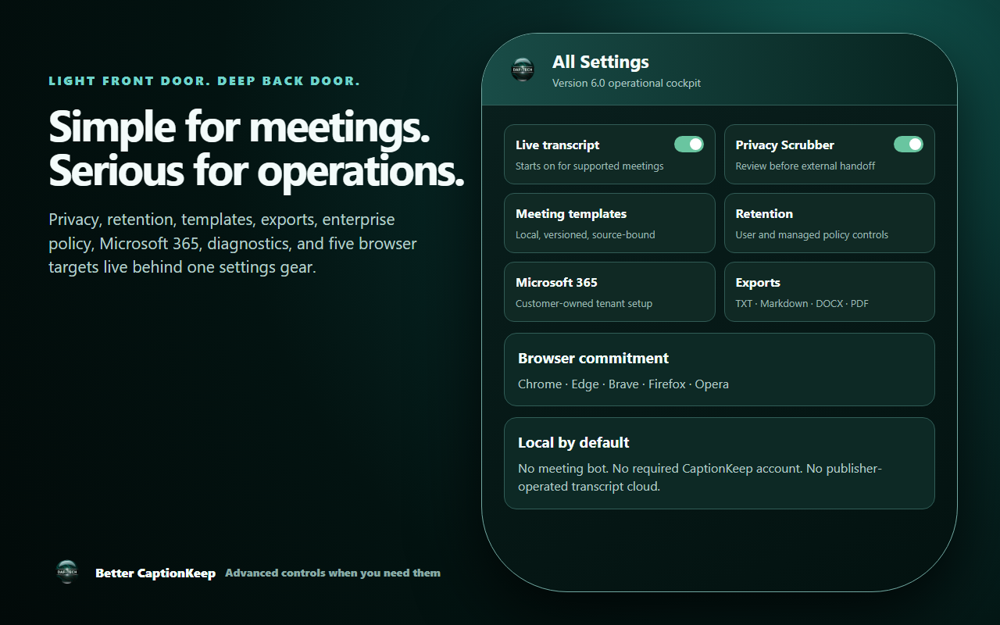

# Better CaptionKeep

<!-- captionkeep-6.0-status:start -->
> **6.0 delivery status:** 6.0.0 is candidate on `master`. Candidate frozen: yes.
> Live provider certification outstanding: chrome, edge, brave, firefox, opera.
> Open release gates: fullScopeAcceptance, accessibilityAndFailureUat, unchangedWindow, storeApproval, publicParity, installedUpgrade. Azure Boards epic: **#335**.
> Owner publication exception: David Farris; accepted unfinished gates: fullScopeAcceptance, accessibilityAndFailureUat, unchangedWindow; live certifications: chrome, edge, brave, firefox, opera. These checks remain unpassed.
> This status does not change historical 5.4 publication records.
<!-- captionkeep-6.0-status:end -->

**A DAF-TECH Product** — Keep the words. Stay in the conversation.




[Trust Center](docs/TRUST-CENTER.md) · [Privacy policy](PRIVACY.md) · [Report a vulnerability](SECURITY.md) · [Report an issue](https://github.com/Mr-GraphnStaff/better-captionkeep/issues) · [Contributing](CONTRIBUTING.md) · [MIT license](LICENSE)

**Testing 6.0?** Use the [hands-on QA and acceptance packet](docs/software-team/TESTER-ACCEPTANCE-6.0.md).
Start with the Brave first-session checks; record results against the actual
installed build. The authoritative release record identifies the current candidate and owner's explicit publication exception; missing live acceptance is not certification.
The [October 24 release-preparation record](docs/release-state/6.0-preparation.md)
identifies the single next Chromium test package at
`P:\Projects\better-captionkeep-dev\dist\uat`; existing Development files are preserved.

Save live captions from Microsoft Teams, Google Meet, and Zoom Web, including the Teams PWA. Live transcript capture starts by default for supported meetings and can be paused with the Capture setting. Export TXT, Markdown, or Word documents, choose a save location, revisit the durable local completed-meeting archive, and select a synchronized interface theme.

> **Distribution status — October 24, 2026:** [GitHub v6.0.0](https://github.com/Mr-GraphnStaff/better-captionkeep/releases/tag/v6.0.0) is published with 15 hash-verified assets. Chrome and Edge Store submission of 6.0 is pending; no Store review or public upgrade is claimed. The last documented public Store baseline is 5.4.0, verified in October; see [Release status](docs/wiki/Release-Status.md).

> **6.0 GitHub publication; Store rollout pending:** The 6.0 line is a real working extension, not a detached wireframe or a completed release. Version `6.0.0` applies the dark sphere shell across the product. The popup keeps one primary meeting decision, direct Teams, Meet, and Zoom launchers, clear capture status and a quiet Meeting Receipt history path. The deeper workspace offers Transcript, Moments, cited Live Notes, Evidence, Templates and source-bound Ask. Rolling Notes retain bounded, restart-safe cited revisions without changing raw captions. Reviewed shareable summaries are implemented locally with synthetic coverage. BYOMCP is deferred from this release. Automated tests, eight-page surface checks, dependency audits, five target packages, Store art, hashes, extension SBOMs and provenance support review. The authoritative release record binds repaired source `9dabe817` and all eight frozen hashes. The published tag is `7470bbf1`, promoted through protected `master`; its packages match the clean bounded-repair build. The original build evidence is preserved. David Farris explicitly authorized publication with the documented unfinished acceptance and unchanged-window exceptions; those checks remain unpassed. Store approval, public parity and installed-upgrade verification remain rollout checks.

### 6.0 release scope

**6.0 MCP scope:** BYOMCP is deferred to a later release. Shipping 6.0 excludes MCP connections, native messaging and helper/tool-execution controls. Local capture, archives, exports, reviewed BYOAI handoff and existing receipt readability remain. Earlier MCP development is preserved separately; it is not a shipping feature or a completed acceptance claim.


**6.0 development addition:** the transcript viewer's More transcript tools
includes a separate reviewed shareable-summary workflow. Explicit excerpt
selection, editable email draft and confidentiality labels preserve the original
transcript. A privileged label requires explicit organizational legal-guidance
confirmation; the tool does not determine privilege or guarantee safe disclosure.
No automatic AI submission or email sending is introduced. See
[scope and acceptance](docs/software-team/SHAREABLE-SUMMARY-6.0.md).

**6.0 browser scope — October 14, 2026:** Chrome, Edge, Brave, Firefox, and Opera
remain separately required. Safari is removed entirely from active 6.0 support,
builds, certification, and release gates. Its [recoverable groundwork](docs/deferred/safari/README.md)
is reserved for a later major version, not current installation guidance.

**All Settings** is a prominent full-width control beneath the popup header. It opens every setting in a full browser tab; it is also available through the browser's extension Options action. The transcript viewer has per-export file types, Print / PDF (choose Save as PDF in the browser dialog), and keyboard shortcuts. The AI handoff offers reusable local task templates without retaining transcripts as templates.

**Chat & links** captures a user-requested snapshot of loaded meeting-chat rows from recognized meeting panes. It does not capture the entire Teams chat application, scroll or fetch older messages, or guarantee full chat history. Unsupported layouts fail explicitly; provider selectors need live UAT. Reviewed extras are separate from spoken evidence and are removed with source archive deletion/retention. **Screenshot** captures only the active supported meeting tab, opens a review preview, and requires confirmation before local retention. Images are not automatically scrubbed and are blocked under forced scrubbed-export policy.

**Translate** uses the browser's feature-detected on-device Translator API, supports incremental translation of visible captions while the panel is open, and creates a separate machine-translated derivative. Language packs may need an initial download. Unsupported devices/language pairs show an explicit fallback to the reviewed AI Translate template; no cloud translation is silently substituted.

Better CaptionKeep is one product: every shipped feature is available to every user without payment, activation, subscription, or a feature tier. Organizational security policy, provider authorization, tenant consent, and browser capability requirements still apply. Google Drive/Docs and OneDrive/SharePoint transport adapters have mocked tests; end-user sign-in, provider app configuration, separate consent, preview integration, and live uploads remain unfinished. See [universal feature access](docs/FEATURE-ACCESS.md) and [competitive feature tracking](docs/COMPETITIVE-FEATURES-2026-10-03.md).

The viewer also exports SRT/WebVTT when a newly imported official Teams transcript contains real media cue boundaries. Live browser observation times and older imports without preserved boundaries are rejected rather than assigned invented timing. Use `npm run build:dev` for development and `npm run build:uat` for the one release candidate; ad hoc output folders are intentionally unsupported.

## Current product

Better CaptionKeep is a free, local-first transcript and meeting-evidence workspace for Microsoft Teams, Google Meet, and Zoom Web. It captures captions already displayed to the participant rather than recording microphone, tab, or system audio. Browser-local history, search, exports, Privacy Scrubber, Evidence Board, on-device translation where the browser supports it, and review-first AI handoff are available without an account, subscription, or publisher-operated transcript service.

## Why Better CaptionKeep is different

**Bring your AI. Keep your control.** Use the ChatGPT, Claude, Microsoft
Copilot, or Gemini workspace you already have. The unified BYOAI framework also
allows future validated adapters for on-device AI and user- or organization-
owned hosted assistants, gateways, and MCP-backed tools. Better CaptionKeep
does not make you buy or use a DAF-TECH AI service.

- No meeting bot and no microphone, tab-audio, system-audio, or video recording.
- No required Better CaptionKeep account, paid tier, activation, or license key.
- Source-linked Evidence Board markers preserve the exact caption behind a
  decision, action, question, risk, follow-up, or important moment.
- On the Fly turns selected meeting words into quick Research, Explain, Reply,
  or Email actions. A set-once preference chooses the AI workspace and Outlook
  work/school, Outlook.com, Gmail, or default mail destination; Review/edit is
  optional. Better CaptionKeep never pastes or submits an AI prompt or sends email.
- Customer-owned Microsoft 365 and AI destinations remain under the user's or
  organization's existing identity, tenant, retention, and policy controls.
- Managed policy, Intune profiles, local retention, privacy disclosures, SBOM,
  release provenance, and reproducible packages support enterprise review.

Zoom Web has been a governed supported provider since the 5.1 line. Its tested subtitle overlay does not reliably expose speaker identity, so Better CaptionKeep records `Unknown speaker` instead of inventing attribution. Native Zoom desktop-client and system-audio capture are not supported.

The 5.3 line introduces **Verified Teams Transcript**: a delegated Microsoft Graph experience that recognizes the active Teams meeting, shows up to five recent eligible Teams meetings, and retrieves a chosen official transcript into the standard viewer and private local history. Live Edge validation exposed that `5.3.1` hid Microsoft 365 in the Store build even though local Dev/UAT overlays passed. Version `5.3.2` is the controlled recovery: every organization supplies its own single-tenant Entra tenant ID and client ID through local setup or managed policy; Store packages contain no shared tenant identity. The Microsoft 365 setup remains visible, validates configuration before sign-in, and rejects tokens issued by any other tenant. See the [5.3.2 recovery record](docs/RELEASE-5.3.2.md), [Graph transcript connector record](docs/GRAPH-TRANSCRIPT-CONNECTOR.md), and [customer Entra registration runbook](docs/ENTRA-GRAPH-APP-REGISTRATION.md).

The `5.3.3` hotfix candidate removes the popup's competing **View Transcript** and **Open Evidence Board** actions. One **Open Live Workspace** action now opens the side panel, where the live transcript and source-linked evidence stay together. The full transcript viewer remains available through **Open full transcript** and for completed history. The hotfix also stops intercepting `Ctrl+V` / `Cmd+V`, restoring the normal paste command. The complete Microsoft 365 transcript-import workspace now appears only in the full-tab **All Settings** page, keeping the popup compact and preventing the transient popup from closing while an administrator copies setup values. See the [5.3.3 hotfix record](docs/RELEASE-5.3.3.md).

## Release lineage

Better CaptionKeep began as a fork of the MIT-licensed Live-Captions-Saver project and is now independently developed. The [5.0 record](docs/RELEASE-5.0.md) established the shared multi-provider architecture, [5.1](docs/RELEASE-5.1.md) added governed Zoom Web support, [5.2](docs/RELEASE-5.2.md) introduced the enterprise security-review line, [5.3.2](docs/RELEASE-5.3.2.md) records the Store-recovery release, and [5.4](docs/RELEASE-5.4.md) is the last documented public Store baseline. [6.0](docs/RELEASE-6.0.md) is published on GitHub from protected `master`, with documented owner exceptions and the bounded Teams repair; Store rollout is pending. Historical release documents preserve what was and was not available in each artifact; they do not override the current product status above.

## Approved 6.0 interface illustrations

David Farris approved this bold DAF-TECH artwork on October 24, 2026. These
synthetic illustrations contain no customer meeting, tenant or account data.
They describe the 6.0 release scope; they are not native browser captures or
proof of Store publication. [Artifact hashes and approval](store-assets/6.0/manifest.json)
bind the reviewed images. [5.4 artwork](store-assets/5.4/README.md) remains historical.

| One-button meeting workspace | Rolling Live Notes |
| --- | --- |
|  |  |

| Capture an important moment | Meeting Receipt |
| --- | --- |
|  |  |



## What it does

- Capture displayed Teams, Google Meet, and Zoom Web captions and available speaker information; Zoom Web uses explicit `Unknown speaker` attribution when its subtitle overlay does not expose a name.
- Export TXT or Markdown with a choice of save location.
- Automatically archive completed meetings locally, reopen them after browser restart, and use speaker aliases. Search the full retained archive by keyword or phrase with meeting-title, speaker, date, and ordering filters, then jump to the matching source caption. The archive does not silently evict older meetings; explicit user deletion and managed retention remain available.
- Optionally include attendee information or hand a transcript to an AI provider.
- Choose an appearance preset, including CaptionKeep (the DAF-TECH default) and High Contrast, through All Settings.
- Work in a branded transcript viewer with a sticky search, speaker-filter, copy, save, and history toolbar.
- Keep the popup calm with expandable settings sections; everyday capture controls remain visible first.
- Open Teams, Zoom Web, or Google Meet from a compact app row, with separate quick-start actions directly below for Meet now or a new meeting.
- Recover an interrupted Google Meet capture from a recent local checkpoint for the same meeting page, then commit it to local history once the meeting ends.
- See capture health in the popup, including the number of caption lines and how recently the last caption arrived.
- Prepare evidence-backed meeting notes with caption IDs for decisions, actions, risks, and unanswered questions before any optional AI handoff.
- Use **On the Fly** on highlighted meeting words or a full caption to prepare a source-linked research, explanation, live-reply, or follow-up task. Review the complete prompt, then explicitly copy and open ChatGPT, Claude, Microsoft Copilot, or Gemini. Better CaptionKeep never submits it.
- Open a slim Chrome or Edge Evidence Board beside the meeting, search the captured transcript, and mark any caption as a decision, action item, question, risk, follow-up, or important moment. Markers stay local, retain their source caption ID, and export as Markdown or provenance JSON without modifying the raw transcript. A reviewed email action opens the user's mail composer without choosing recipients or sending automatically.
- Export/import user preferences or let administrators enforce selected controls through managed browser policy.
- Choose a browser-following or explicit interface language from 38 packaged catalogs. Non-English choices are visibly labeled as uncertified AI-assisted previews and fall back to English; administrators can lock the choice with `forceUiLocale`.
- Open a focused, plain-language GitHub form for a bug, feature idea, or language correction. The forms warn users not to include transcript text, participant details, meeting links, tenant identifiers, or other private meeting data.
- When enabled by an organization, find the current or five recent Teams meetings and explicitly import an authorized official transcript with a separate raw source and verifiable local provenance.
- In 6.0, live transcript capture starts by default for supported meetings and can be paused in Capture controls. The Live Workspace offers recovery when meeting captions are unavailable. Teams attendee capture and Microsoft 365 transcription each require their own visible user action. The interface distinguishes the local browser copy from the official tenant-retained transcript and reports when role, meeting state, or tenant policy prevents an action.

Better CaptionKeep is BYOAI today: it prepares short local instructions plus a complete, coverage-checked Markdown evidence file and bounded numbered copy chunks. You review the selected privacy mode, included/omitted counts, chunk count, and file size before deciding whether anything leaves the extension. Privacy Scrubber is visible and on by default: it masks supported sensitive patterns consistently across the complete handoff, leaves the saved original unchanged, and requires a second confirmation before unmasked material can be copied. Pattern detection reduces accidental disclosure risk but does not guarantee HIPAA, PCI DSS, or other regulatory compliance. For managed ChatGPT or Claude accounts, first open the approved enterprise workspace and copy its URL into **Settings → Enterprise destinations**. Better CaptionKeep accepts only official HTTPS provider domains, never places transcript text in a provider URL, and asks you to confirm the active workspace before attaching or pasting. Preferences, including enterprise destinations and the selected theme, may use browser sync; see the [privacy policy](PRIVACY.md) for the full data-handling details.

## Themes

Open the extension popup and select **Settings → Appearance → Theme**. The selection applies immediately to the popup, transcript viewer, export page, and AI handoff page. CaptionKeep preserves the original cream-and-teal appearance; Follow system responds to the operating-system light or dark preference.

Choose **Automatically** to save transcripts without opening a Better CaptionKeep save page, or **Ask me each time** to choose a different location for every transcript. Advanced download settings can remember a dedicated local folder where the browser permits it, configure a subfolder beneath Downloads, open Downloads, and recover pending exports.

## Install for local testing

The last documented Chrome and Edge Store baseline is `5.4.0`; 6.0 is published on GitHub and its Store submission is pending. Installed-upgrade and post-upgrade functional smoke verification remain separate evidence. Use the [wiki installation page](https://github.com/Mr-GraphnStaff/better-captionkeep/wiki/Installation) for ordinary installation; the instructions below are for controlled local testing only.

### Three lifecycle environments

Generated output has exactly three stable locations:

Use one active source checkout, `P:\Projects\better-captionkeep-dev`, with the
three generated lanes below. Separate top-level UAT/production checkouts are
archived outside `P:\Projects`, under `P:\projectsArchive`. Only `dist/prod`
supplies published GitHub distribution assets and Store submissions; `dist/dev`
and `dist/uat` are not published. Generated `dist/` files remain ignored by Git.

- `dist/dev` — current development build.
- `dist/uat` — the single QA/UAT release candidate loaded unpacked in Chrome or Edge.
- `dist/prod` — directly loadable production build plus Store packages, deployment bundles, hashes, and provenance.

Run `npm run build:targets` to refresh all three directly loadable roots without creating browser-specific, timestamped, feature-review, or frozen copies. Dev, UAT, and local Prod each have a separate stable extension identity and local storage. Rebuilding or upgrading a lane does not change its Microsoft redirect URI and does not overwrite a Store installation. Store installations retain the stable identity assigned by their Store.

Dev and UAT may use an ignored local Graph overlay for controlled testing. Production—whether loaded from `dist/prod` or installed from a Store—uses the customer-facing setup fields or managed policy. Tenant and client identifiers are excluded from source and release ZIPs. See the [Dev/UAT Graph runbook](docs/DEV-UAT-GRAPH.md).

For Chrome, open `chrome://extensions`; for Edge, open `edge://extensions`. Enable Developer mode, choose **Load unpacked**, and select `dist/uat`. This is the only supported release-candidate path.

To inspect the promoted production build locally, choose **Load unpacked** and select `dist/prod`. The production root has its own `manifest.json`; ZIPs and deployment evidence in that same lane are ignored by Chromium when it loads the extension.

1. Open Microsoft Edge and visit `edge://extensions`.
2. Enable Developer mode.
3. Choose **Load unpacked** and select `dist/uat`.
4. Open a supported meeting. Better CaptionKeep requests live captions automatically unless **Live transcript capture** is switched off.

After the project folder move, reload the extension from its new location if needed.

## Development

Use Node.js 22 or newer. For the shipping 6.0 suite:

```sh
npm ci
npm run test:release
```

For the full developer suite, including retained, unshipped MCP implementation
tests, install the nested locked dependencies before running `npm test`:

```sh
npm ci
npm run setup:helper
npm test
```

Helper dependencies are development-only and are not required or shipped by the
6.0 release gate. Azure Development uses the full-suite sequence above.

- `npm run lint`: validate the extension manifest and assets.
- `npm run locales:generate`: regenerate all packaged locale catalogs from the reviewed English source and preview translation map.
- `npm run build`: build the Edge Store ZIP in `dist/prod/`.
- `npm run build:dev`: refresh only `dist/dev`.
- `npm run build:uat`: refresh only `dist/uat`.
- `npm run build:prod`: refresh only the directly loadable `dist/prod` root (and clear older production artifacts).
- `npm run build:intune`: generate the Edge force-install and managed-policy bundle in `dist/prod/intune-edge/`.
- `npm run build:intune:chrome`: after the Chrome Store assigns an extension ID, generate the Chrome force-install and managed-policy bundle in `dist/prod/intune-chrome/`.
- `npm run build:intune:local-only`: generate the optional high-security bundle that disables AI handoff.
- `npm run build:chrome-store`: generate and verify the production-labeled Chrome Web Store package in `dist/prod/`.
- `npm run build:browsers && npm run package:browsers`: build and hash separate Chrome, Edge, Brave, Opera, and Firefox packages, emit the CycloneDX SBOM, and create the still-pending live-certification record.
- `npm run test:browser-surfaces`: record isolated installed-browser rendering evidence without confusing it with provider or extension-runtime certification.
- `npm run store:assets:render`: regenerate the versioned synthetic-data 6.0 screenshots, promotional artwork, and asset hashes.
- Test capture, TXT/Markdown export, Save As, saved sessions, and Teams PWA behavior in Edge before publication. Zoom development also requires unpacked Chrome and Edge UAT against the Web client.

Release and enterprise references: [standalone product record](docs/PROJECT-EMERGENCE.md), [5.1 release notes](docs/RELEASE-NOTES-5.1.md), [security architecture and threat model](docs/SECURITY-ARCHITECTURE.md), [security and privacy design](docs/SECURITY-PRIVACY.md), [AI-extension assurance standard](docs/AI-EXTENSION-ASSURANCE.md), [EUC deployment](docs/EUC-DEPLOYMENT.md), [enterprise security review record](docs/ENTERPRISE-SECURITY-REVIEW.md), [5.2 development gate](docs/RELEASE-5.2.md), [5.3.1 release record](docs/RELEASE-5.3.1.md), [withdrawn 5.3.0 record](docs/RELEASE-5.3.md), [Dev/UAT/Prod Graph runbook](docs/DEV-UAT-GRAPH.md), [enterprise Graph transcript connector record](docs/GRAPH-TRANSCRIPT-CONNECTOR.md), [Entra app-registration runbook](docs/ENTRA-GRAPH-APP-REGISTRATION.md), [platform adapter boundary](docs/PLATFORM-ADAPTERS.md), the completed [5.1 release record](docs/RELEASE-5.1.md), [Edge publishing pipeline](docs/EDGE-PUBLISH-PIPELINE.md), and [Chrome publishing pipeline](docs/CHROME-PUBLISH-PIPELINE.md).

Browser API identifiers such as `chrome.storage` remain unchanged because Edge implements those Chromium extension APIs. Internal source paths remain stable.

## Publication status

Target stores: **Microsoft Edge Add-ons and the Chrome Web Store**. Version 4.7 was retired from publication. The last documented public Store baseline is `5.4.0`; installed-upgrade and post-upgrade functional smoke remain separate verification gates. Version `6.0.0` is published on GitHub with explicit owner exceptions to incomplete acceptance and the test window. Its Chrome and Edge Store submissions are pending; Store availability is a separate outcome. The [privacy policy](PRIVACY.md) is published. Use the [5.4 release record](docs/RELEASE-5.4.md), [6.0 release record](docs/RELEASE-6.0.md), and [Chrome Web Store checklist](docs/CHROME-WEB-STORE-SUBMISSION.md) for per-Store evidence.

Production changes reach `master` only through review and validation. See the [contribution guide](CONTRIBUTING.md) and [release process](docs/RELEASE_PROCESS.md).

## Attribution and license

Better CaptionKeep originated from [Live-Captions-Saver](https://github.com/Zerg00s/Live-Captions-Saver) by Denis Molodtsov and is now independently developed as its own product and GitHub repository. The original MIT license, copyright, and permission notices remain preserved in LICENSE and in the packaged extension.

Not affiliated with or endorsed by Microsoft.

## October 24 publication decision

David Farris explicitly authorized “Publish with a documented owner exception.”
The [exception report](docs/release-state/6.0-owner-exception.md) records known
UAT gaps, the waived test window and unchanged permissions. The machine record
binds source, all eight artifact hashes, Store targets and the report digest.
No unfinished test is recorded as passed. Production distributions come only
from `dist/prod`; approved shipping ZIP bytes remain unchanged.

## GitHub publication evidence

[GitHub v6.0.0](https://github.com/Mr-GraphnStaff/better-captionkeep/releases/tag/v6.0.0)
was published on October 24, 2026 at 03:47:23 America/Chicago (08:47:23 UTC),
with 15 assets. Tag `7470bbf1fe2347ce9c850ed7666ac326e79e7278` and
[Package run 40079055054](https://github.com/Mr-GraphnStaff/better-captionkeep/actions/runs/40079055054)
bind the repaired candidate, eight frozen hashes and 14 verified attestation
subjects. GitHub's API reports server immutability disabled; the approved
artifacts are operationally frozen and hash-verified. The release remains in
the logical candidate state until Store approval, public listing parity and
installed-upgrade verification are recorded. Store submission is pending.
