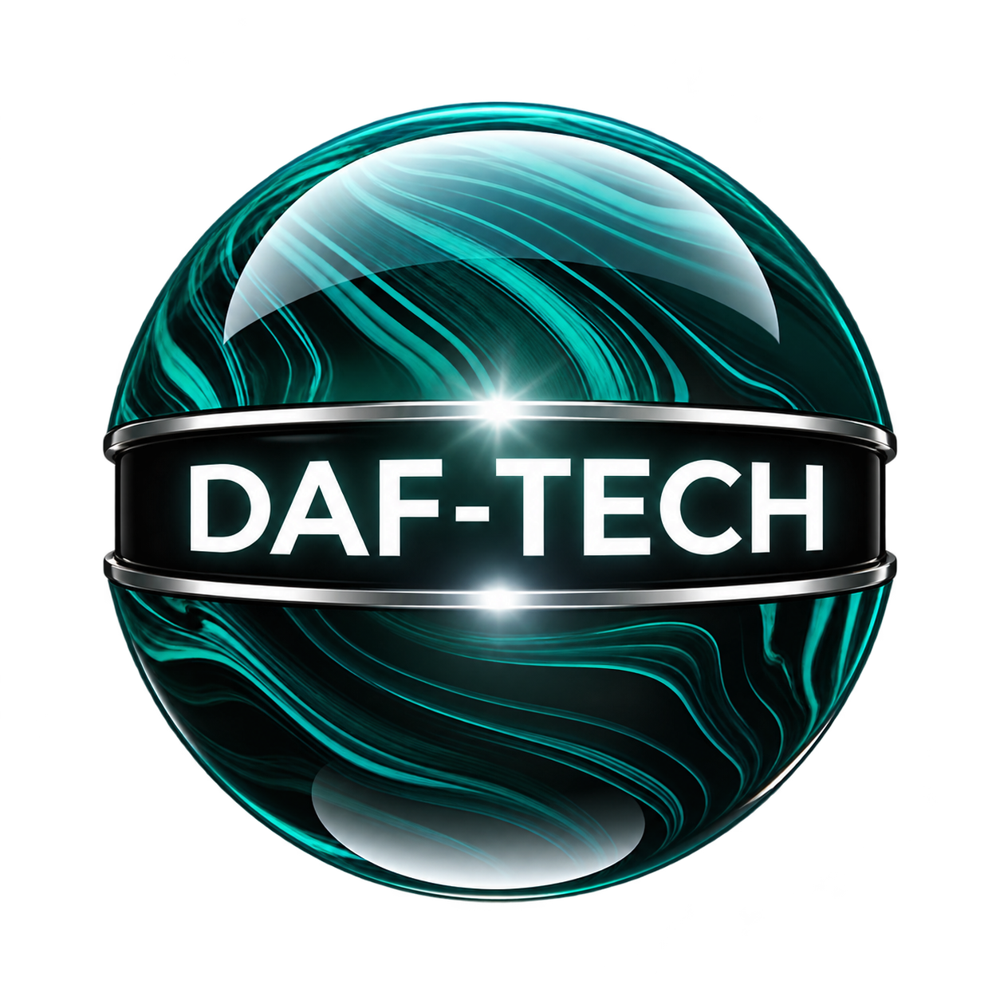

# Better CaptionKeep

**A DAF-TECH product — Keep the meeting. Keep the evidence.**

Save captions displayed in Microsoft Teams web/PWA, Google Meet and Zoom Web. Keep a local transcript, review source-linked notes and evidence, and export the words you need. Better CaptionKeep is free, with no required BCK account, subscription or paid feature tier. It does not record microphone audio or video or join meetings as a bot.

## Install and get started

- [Chrome Web Store](https://chromewebstore.google.com/detail/better-captionkeep/nabjdlnkkaonnbnimnmnhjcbigceebml) · [Microsoft Edge Add-ons](https://microsoftedge.microsoft.com/addons/detail/better-captionkeep/edefcbdhahfolgkoamkbknjppojpaffk)
- [Browser installation and Microsoft 365 setup](https://github.com/Mr-GraphnStaff/better-captionkeep/wiki/Browser-Installation-and-Microsoft-365) — Chrome, Edge, Brave, Opera and Firefox, with browser-specific limits.
- [Capture your first meeting](https://github.com/Mr-GraphnStaff/better-captionkeep/wiki/Getting-Started) · [Review and export](https://github.com/Mr-GraphnStaff/better-captionkeep/wiki/Review-Save-and-Export)

The extension's [6.0.3 GitHub release](https://github.com/Mr-GraphnStaff/better-captionkeep/releases/tag/v6.0.3) and separate [signed Windows Administrator Setup 6.0.3-r2](https://github.com/Mr-GraphnStaff/better-captionkeep/releases/tag/admin-setup-v6.0.3-r2) are available. Browser Store versions can lag during review. Check [current versions and known limitations](https://github.com/Mr-GraphnStaff/better-captionkeep/wiki/Release-Status) and your installed version before following version-specific steps. A Firefox unsigned ZIP is a temporary developer installation, not a permanent Mozilla-signed end-user release.

## Keep the meeting useful

- Live Workspace and local history let you revisit captured captions.
- Source-linked markers, reviewed Notes/Ask and Capture Moments keep derived work separate from the original transcript.
- Export TXT, Markdown or Word (DOCX); Print/PDF uses the browser's print dialog. SRT/WebVTT requires imported official transcripts with real media cue boundaries.
- Privacy Scrubber masks supported patterns locally while retaining the source; it does not guarantee anonymization.
- Optional BYOAI handoff prepares a prompt for your chosen workspace. You review and submit it there; BCK does not paste or submit it automatically. Email actions open recipient-free drafts and do not send mail.
- Zoom Web can omit speaker attribution; BCK uses Unknown speaker rather than inventing a name.

## Optional Microsoft 365 and organization setup

Local displayed-caption capture works independently of Microsoft 365/Intune setup. An organization can use its own Entra app and delegated permissions to request a selected official Teams transcript. Version 6.0.3 adds a user-initiated connection to the separately installed, signed Windows administrator app. The guided provisioning route targets Edge/Chrome; manual browser setup and its exact callback are documented in the Wiki.

**Official transcript import has an [open retrieval issue](https://github.com/Mr-GraphnStaff/better-captionkeep/issues/255).** The extension can report incomplete processing when its lookup returns no transcript; that does not establish the cause. Verify sign-in, discovery and import independently with a synthetic meeting before organizational reliance. Microsoft licensing, consent, access and organization policy still apply.

[Administrator deployment](https://github.com/Mr-GraphnStaff/better-captionkeep/wiki/Administrator-Deployment) · [Security and permissions](https://github.com/Mr-GraphnStaff/better-captionkeep/wiki/Deployment-Security-and-Permissions) · [Manual app registration](docs/ENTRA-GRAPH-APP-REGISTRATION.md)

## Privacy, help and security reports

[Privacy policy](PRIVACY.md) · [Privacy and data boundaries](https://github.com/Mr-GraphnStaff/better-captionkeep/wiki/Privacy-and-Data-Boundaries) · [Support](SUPPORT.md) · [Troubleshooting](https://github.com/Mr-GraphnStaff/better-captionkeep/wiki/Troubleshooting)

Use the [question/feedback form](https://github.com/Mr-GraphnStaff/better-captionkeep/issues/new?template=feedback.yml) or [bug report](https://github.com/Mr-GraphnStaff/better-captionkeep/issues/new?template=bug_report.yml). Issues are public: share versions and sanitized errors, not meeting content, credentials, organization identifiers or raw deployment receipts. Report sensitive vulnerabilities through [private vulnerability reporting](https://github.com/Mr-GraphnStaff/better-captionkeep/security/advisories/new); see [SECURITY.md](SECURITY.md).

Safari, MCP connections/external tool execution, native Teams desktop capture and the later Intune-console settings editor are outside this release. Package availability does not certify a full live browser/provider matrix.

## Source and attribution

[Contributing](CONTRIBUTING.md) · [Development and UAT](docs/wiki/Development-and-UAT.md) · [Trust Center](docs/TRUST-CENTER.md) · [MIT license](LICENSE)

Source-build instructions apply to the checked-out revision; released packages are the documented starting point for evaluation. Scoped work branches and their drafts are not released product versions. Better CaptionKeep originated from Denis Molodtsov's MIT-licensed Live-Captions-Saver and is independently developed. Preserve the original license and attribution.

Maintainer source-freeze and acceptance records

These machine-generated blocks retain source/candidate evidence and unfinished acceptance checks. They are not the live Store status. Use the Wiki's dated version table for downloads and distribution observations.

<!-- captionkeep-6.0.3-status:start -->
> **6.0.3 delivery status:** 6.0.3 is candidate on `master`. Candidate frozen: yes.
> Live provider certification outstanding: chrome, edge, brave, firefox, opera.
> Open release gates: fullScopeAcceptance, accessibilityAndFailureUat, unchangedWindow, storeApproval, publicParity, installedUpgrade. Azure Boards epic: **#395**.
> Owner publication exception: David Farris; accepted unfinished gates: fullScopeAcceptance, accessibilityAndFailureUat, unchangedWindow; live certifications: chrome, edge, brave, firefox, opera. These checks remain unpassed.
> This development record does not change prior publication records or inherit prior owner exceptions.
<!-- captionkeep-6.0.3-status:end -->

<!-- captionkeep-6.0-status:start -->
> **6.0 delivery status:** 6.0.0 is candidate on `master`. Candidate frozen: yes.
> Live provider certification outstanding: chrome, edge, brave, firefox, opera.
> Open release gates: fullScopeAcceptance, accessibilityAndFailureUat, unchangedWindow, storeApproval, publicParity, installedUpgrade. Azure Boards epic: **#335**.
> Owner publication exception: David Farris; accepted unfinished gates: fullScopeAcceptance, accessibilityAndFailureUat, unchangedWindow; live certifications: chrome, edge, brave, firefox, opera. These checks remain unpassed.
> This status does not change historical 5.4 publication records.
<!-- captionkeep-6.0-status:end -->

